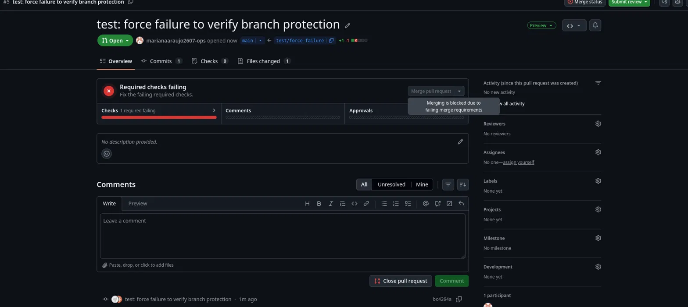
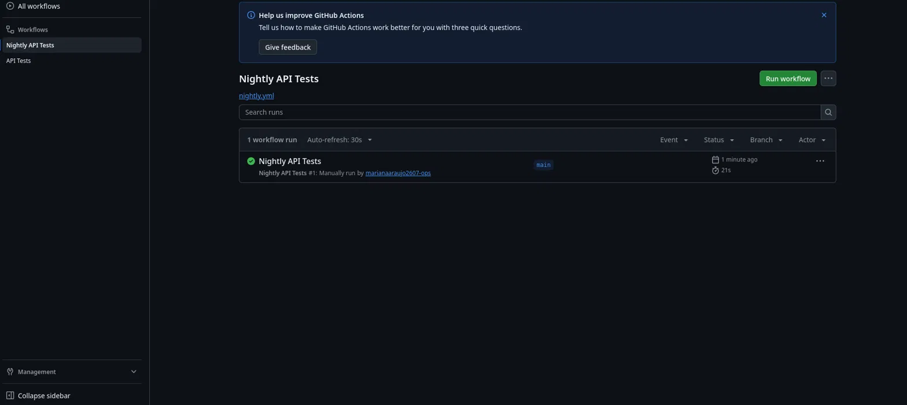

# Restful-Booker API Test Automation


Automated API test suite for the public [Restful-Booker](https://restful-booker.herokuapp.com) service, built with **Postman** and **Newman**, and executed on every push, pull request and nightly via **GitHub Actions**.

## What this covers

- **Health check**: `/ping` status and response time
- **CRUD flow**: token → create → read → update → partial update → delete → read after delete, chaining data between requests
- **Negative tests**: missing/invalid token, nonexistent ids, empty body, wrong credentials
- **Schema validation**: JSON schema check on the booking response
- **Data-driven testing**: the CRUD flow runs once per record in `data/bookings.json`
- **Reporting**: HTML report (htmlextra) uploaded as a CI artifact

## Tech stack

Postman (collection v2.1) · Newman · newman-reporter-htmlextra · GitHub Actions · Node 22

## Project structure

```
.
├── collections/        # Postman collection (exported v2.1)
├── environments/       # Postman environment (secrets/tokens left empty)
├── data/               # Iteration data for data-driven runs
├── docs/               # Screenshots used in this README
├── .github/workflows/
│   ├── tests.yml       # Runs on push to main and on pull requests
│   └── nightly.yml     # Scheduled daily run + manual trigger
└── package.json        # npm scripts
```

## How to run

```bash
npm ci
npm test            # full collection, 25 assertions
npm run test:data   # CRUD flow x 3 bookings, 39 assertions
```

HTML reports are generated in `reports/`.

## CI/CD

| Workflow | Trigger | Purpose |
|---|---|---|
| `API Tests` | push to `main`, pull requests | Required check (`test`) before merging |
| `Nightly API Tests` | daily at 06:00 UTC (03:00 São Paulo) + manual | Detect API regressions without code changes |

The `main` branch is protected by a ruleset: changes require a pull request and the `test` check must pass. To prove it, a pull request with an intentionally broken base URL was opened, and merging was blocked:



A passing run, with the report attached as an artifact:



## API behaviors found

Testing revealed behaviors that differ from common REST conventions. The tests assert the **actual** behavior and document it:

| Scenario | Actual response | Typical expectation |
|---|---|---|
| `DELETE /booking/:id` success | 201 Created | 200 or 204 |
| `PUT`/`PATCH`/`DELETE` on nonexistent id | 405 Method Not Allowed | 404 |
| Missing or invalid token | 403 Forbidden | 401 |
| `POST /booking` with empty body | 500 Internal Server Error | 400 |
| `POST /auth` with wrong password | 200 with `{"reason":"Bad credentials"}` | 401 |

## Postman vs pytest

I also built a [pytest-based project](https://github.com/marianaaraujo2607-ops/qa-automation-portfolio). Rule of thumb:

- **Postman + Newman**: fast to build, readable by non-developers, great for API contract checks and quick CI. Logic gets awkward as it grows.
- **pytest**: better for complex logic, reuse, fixtures and integration with other systems. Needs more code.

## Limitations

- The public API is shared and resets periodically, so ids and data are not stable. The tests create their own data.
- Postman's free plan blocks data files in the Collection Runner, so data-driven runs use Newman.
- Credentials in the environment file are the public demo ones; real secrets should go in CI secrets.
